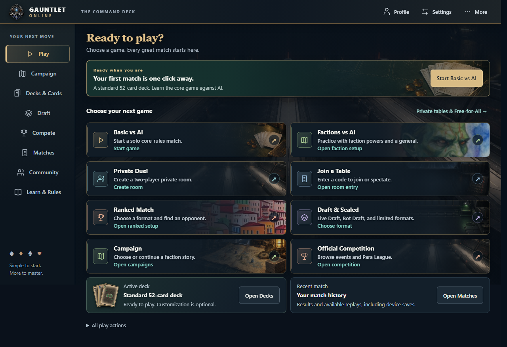
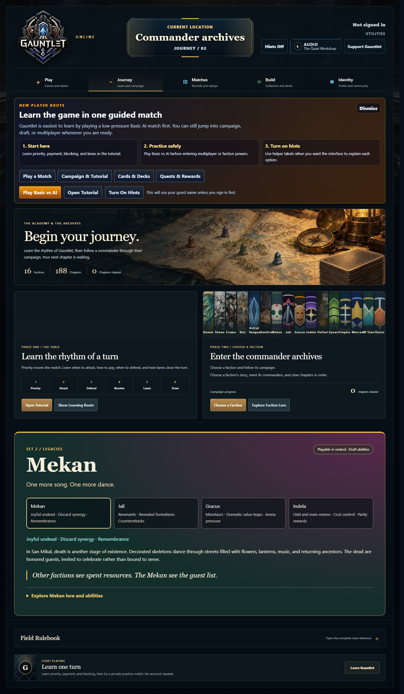
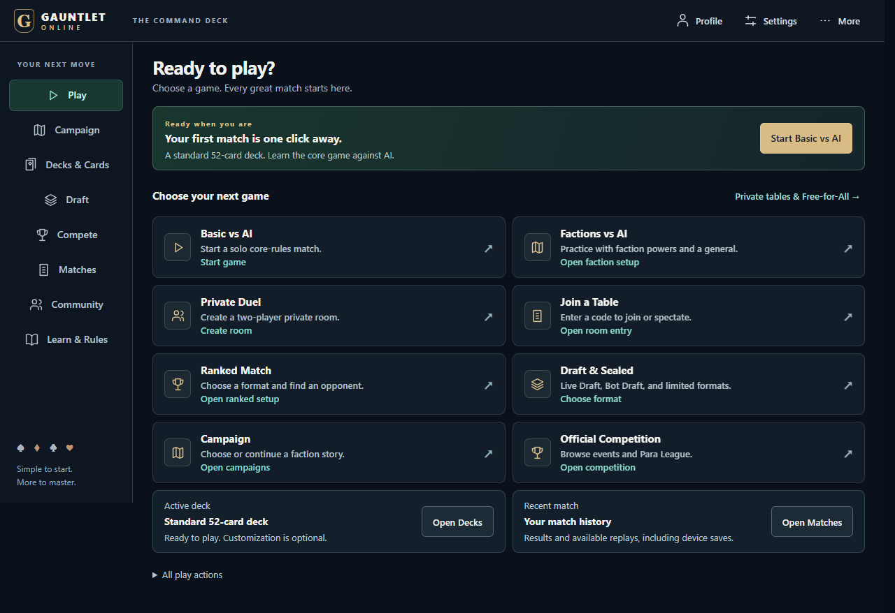
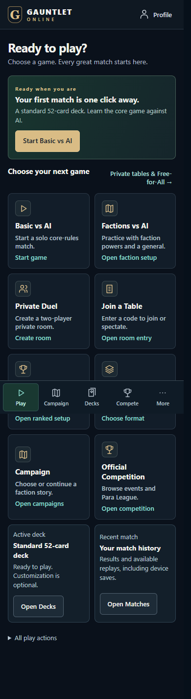
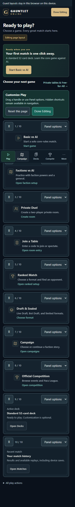

# Command Deck 2.1 implementation report

The player menu hierarchy is replaced by a compact Command Deck. Play is the ordinary entry point; eight labeled game actions fit at 1366×768 and 1280×720. This branch is for an unmerged draft PR. It does not deploy the site or execute a production migration.

## Existing-artwork visual refinement — October 29

The Command Deck now reuses the previous menu's arena, workshop, archive, identity chamber, expedition, and tutorial scenes. Decorative artwork gives each destination a backdrop and illustrates action tiles. The existing Gauntlet crest replaces the generic letter badge. Deliberate artwork crops, restrained destination accents, inset panel edges, and framed action arrows connect the compact interface to the existing game presentation. Campaign tiles pair their published covers with faction thumbnails. No new image assets were generated and no gameplay or navigation behavior changed.

The suggested-action panel uses the tutorial table for a first game, the appropriate room scene for recovery or invitations, and the actual next chapter image when continuing a campaign. The active-deck panel shows up to three selected card printings from the current deck, falling back to published faction artwork or standard playing cards. Existing action priority and account data continue to determine the displayed content.

The artwork occupies existing space: all eight Play actions still end at 711.47px in a 768px viewport and 692.47px in a 720px viewport. Labels and click outcomes remain visible. Images are decorative and do not intercept clicks or dragging. Background illustrations disappear in forced-colors mode; motion respects reduced-motion settings. Tile images load lazily, and the existing menu scenes are shared through the browser cache.

Validation for this refinement: **63 client tests passed**, plus **4 existing browser scenarios** covering both desktop sizes, 320/390/683/820px reflow, axe accessibility checks, keyboard/native layout editing, resets, guest reload, destinations and browser navigation. Full-source lint, production compilation, and every unchanged bundle budget passed: main **173.6/180 KiB**, player JavaScript **749.5/759 KiB**. The normal client production configuration and shader pruning ran in an isolated output directory to keep the interactive local preview available. Final screenshot capture also verified artwork loading and forced-colors decoration removal. Earlier implementation validation below describes the preceding full qualification run.

Latest previews: [Play on desktop](reviews/command-deck/artwork-play-desktop.png), [Compete](reviews/command-deck/artwork-compete.png), [Campaign](reviews/command-deck/artwork-campaign.png), and [Play on mobile](reviews/command-deck/artwork-play-mobile.png).

## Player experience

| Area | Result |
| --- | --- |
| Global navigation | 190px desktop rail, 60px header, five labeled mobile destinations, accessible More sheet, Profile and Settings. Server-authorized Admin remains separate. |
| Play | Contextual resume/invitation/campaign/practice action, eight explicit action tiles, active deck, actual recent match/replay when available. |
| Private tables | Direct Duel creation; Free-for-All, room code, Join as Player and Spectate on a focused screen. Existing sharing and room lobbies retained. |
| Ranked | Classic/Faction format, BO1/BO3, faction, General, applicable saved deck, explicit queue/leave actions. Deck editor returns to the retained setup. |
| Draft | Published set and availability, Live Draft, Bot Draft, Sealed and their saved-deck Limited League queues. |
| Campaign | Actual published factions and progress, Continue Campaign, quick references, preserved chapter briefings, dialogue and lore. |
| Decks and cards | Active deck/editor, collection, earned packs first, collector purchases, saved versions/legality, Draft/Sealed library. Unsaved edits warn before leaving. |
| Competition | Separate Ranked, Events, Para League and Standings destinations using existing server data and eligibility. |
| Matches | Opponent/result/format/date first; record and replay actions distinct; local/cloud provenance, imports, exports and transcripts retained. |
| Community | Direct Friends, Challenges, Messages and Invitations views, persistent actionable notices and actual unread counts. |
| Profile and Settings | Account/recovery controls, record, Gold & Library, portrait/cosmetics/featured decks, layout settings, audio, helper labels and gameplay shortcuts. |

Browser navigation preserves invitation, public match/replay/profile, claim, recovery and Admin links. Active queues remain visible while browsing or editing layouts. Existing gameplay handlers, engines, rewards, economies, content and operator authorization are reused. Draft sign-in returns to Draft, and published Admin presentation overrides still reach the corresponding focused player screens.

## Layout Studio and storage

More → Customize this page and Profile → Page Layouts → Customize Mode enter opt-in editing. Eligible panels have handle-only dragging, keyboard/touch movement menus, hide/show placeholders, position announcements and confirmed page/all-page resets. Normal tile actions are inert during editing. Done Editing restores ordinary interaction; hidden shortcuts remain reachable through permanent navigation/action directories.

The version-1 layout registry contains a bounded allowlist per landing page. Campaign IDs are derived from published content. Required recovery, queue, invitation, account and workflow controls stay outside customizable panels. Mobile editing uses one column and 44px controls.

Guests save to browser storage, with in-session fallback when storage is denied. Authenticated `GET/PUT /api/account/layouts` use the existing Bearer authentication and stable account ID. Compare-and-set revisions reject conflicting writes with HTTP 409; users can load the saved version or retry their arrangement. Guest/account layouts require an explicit choice before replacement. Successful server responses alone display synced status. Request scopes prevent late account responses from changing another player's layout, and already-authorized queued saves finish across menu unmounts.

Local deployments use a locked, atomic, fsynced layout sidecar included in runtime backups. Supabase deployments use `gauntlet_account_layouts` with RLS and service-role-only access. The narrow migration is [command-deck-layouts.sql](../server/migrations/command-deck-layouts.sql). **It has not been applied to production.** Review and apply it before enabling account layout persistence on a Supabase deployment; the UI reports loading/saving errors honestly if the table is unavailable.

## Validation

- Server: 574 tests passed, 0 failed, 0 skipped, including original gameplay/account/Admin integration coverage.
- Layout/storage: guest fallback, schema bounds, stale scopes, account conflicts, delayed saves, private SQL grants/RLS, backup/restore and local concurrency exercised. The migration was executed only in an isolated PGlite test database.
- Client full run: **110 suites and 851 tests passed** with `--runInBand --testTimeout=20000`. An earlier run had six failures from an obsolete lore assertion and timing-sensitive tests while the server suite was running concurrently. The obsolete assertion was corrected; the final full run and targeted regression runs passed.
- Final focused client checks: **8 suites and 107 tests passed** after the published-copy, heading-level and sign-in refinements. A final **48 menu/shell tests passed** after preserving custom overlines and descriptions. The dedicated server prose checks also passed all 3 tests.
- Qualification: 52 tests passed. Content validation verified 644 cards and 1,814 immutable asset references.
- Command Deck browser suite: **12 scenarios passed in the final consolidated run** covering core menu journeys, native dragging and alternative controls, resets, invitations, real queues, account isolation and cross-context persistence, blocked-storage round trips, campaign briefings and guarded deck editing. Screenshots and desktop measurements were refreshed from this run.
- Existing browser usability suite: **6 scenarios passed**, including two live clients, reconnect, faction abilities, spectator privacy, context loss and renderer recovery, keyboard access, responsive layout and reduced motion.
- Deck workshop suite: **5 scenarios passed** across the initial run and targeted rerun. The run exposed generic shell button styles overriding compact deck-card sizes; the shell now leaves the card grid's measured styles intact. Tests cover rename/version behavior, swaps and boxes, responsive previews, collector card display, full rules and sequential pack reveals.
- Migrated player-flow and Draft regressions: **21 scenarios passed** across the initial run and targeted rerun. These include all 39 Bot Draft picks, saving and retry, Limited League entry, invitation entry, startup recovery, returning after sign-in, queue/account isolation, replay export/import, four-player matches and disconnected Draft recovery. Initial failures from retired heading expectations, the startup fixture and heading-level accessibility were corrected and the affected cases rerun successfully.
- Existing collection, economy and Admin browser fixtures now use the replacement menus and retain their underlying assertions. The complete Admin/economy/renderer CI matrix was not rerun locally; those checks remain in the PR workflow.
- Desktop geometry: the eighth action ends at 711.47px in a 768px viewport and 692.47px in a 720px viewport. [Measured rectangles](reviews/command-deck/above-the-fold.json).
- Reflow and axe checks: 320px, 390px, 820px tablet, and 683×384 CSS viewport as 200%-equivalent desktop reflow; keyboard focus, More sheet, reduced motion and horizontal overflow checked. Actual browser chrome zoom and physical assistive devices were not separately exercised.
- Production build and all existing bundle budgets passed: main **173.1 / 180 KiB**, player JavaScript **748.6 / 759 KiB**, largest async chunk **274.2 / 350 KiB**, initial Admin **17.3 / 20 KiB**, all lazy Admin **61.0 / 61 KiB** (gzip, rounded). The menu and Layout Studio load in a dedicated lazy chunk; budget ceilings were unchanged.

Run `npm run test:e2e:command-deck` for the isolated browser suite (ports 3110/4110 and local test accounts). The PR workflow now includes this suite alongside the existing browser suites. Standard build, bundle, client, server and content checks remain available. Browser tests create only local test data.

## Review images

Before desktop:

Command Deck at 1280×720 (full-page capture; the eighth action is above the 720px fold):

Mobile navigation and editing:

Additional views: [Campaign](reviews/command-deck/after-campaign.png), [Chapter briefing](reviews/command-deck/after-campaign-briefing.png), [Decks & Cards](reviews/command-deck/after-decks-cards.png), [Deck Editor](reviews/command-deck/after-deck-editor.png), [Draft](reviews/command-deck/after-draft.png), [Compete](reviews/command-deck/after-compete.png), [Ranked Setup](reviews/command-deck/after-ranked-setup.png), [Matches](reviews/command-deck/after-matches.png), [Community](reviews/command-deck/after-community.png), [Learn & Rules](reviews/command-deck/after-learn-rules.png), [Profile](reviews/command-deck/after-profile.png), [Settings](reviews/command-deck/after-settings.png), [More](reviews/command-deck/after-more.png).

## Review boundary

The implementation is based on current main at d5778d6596588cea0d8f927adc53de89181e22ef. The original checkout's pre-existing edits were preserved; the proposed changes live in a separate worktree and branch. Legacy menu components and their dedicated styles/tests were retired; shared gameplay styling remains.

No rule, reward, entitlement or economic behavior was redesigned. Layout preferences do not alter those stores. Live production event registration, purchases, deployment and the production SQL migration are outside this verification run.
