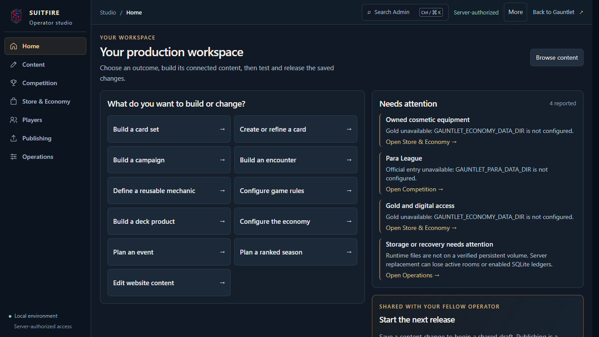
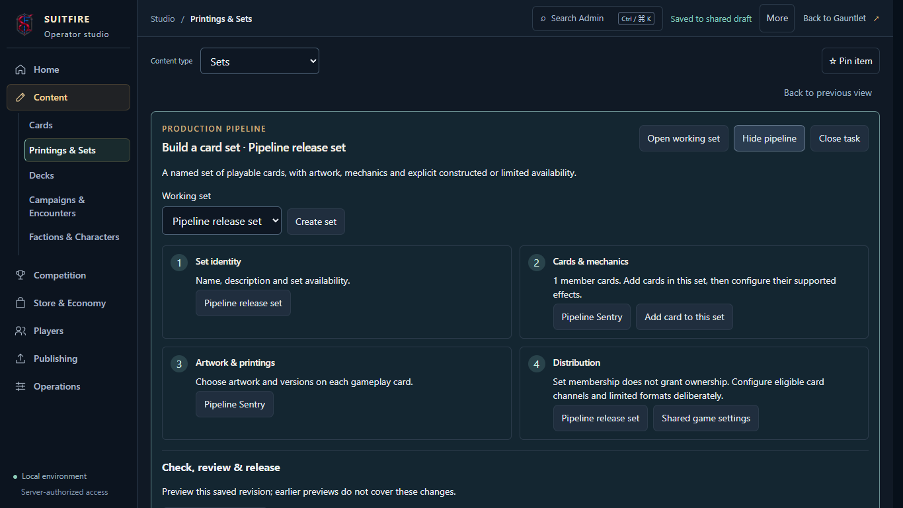

# Connected Admin production pipelines

This follow-up to the Admin refinement makes the starting point a concrete outcome. Home offers named tasks; a task retains its working object while the operator edits connected records, creates dependencies, tests saved content, and opens the existing shared release review. The live site does not contain this draft PR.

The pipeline registry is a read-only projection over the existing authoring contracts. It does not introduce a second draft, job queue, database table, publication authority, or page builder.

| Pipeline | Meaningful output and connections |
| --- | --- |
| Build a card set | Set identity → cards created in that set → mechanics and printings → explicit distribution |
| Create or refine a card | Identity and wording → executable mechanics → immutable artwork → saved-draft engine test |
| Build a campaign | Qualified faction family → campaign introduction and characters → ordered encounters → chapter setup and tests |
| Build an encounter | Existing campaign → story and sequence → opponent, deck and rules → presentation and engine test |
| Define a reusable mechanic | Versioned behavior → actual card consumers, including contextual card creation → consumer tests |
| Configure game rules | Encounter rule modifiers and their consumers; shared hand size and pack settings have a separate scope |
| Build a deck product | Player deck recipe → price and availability → delivery dependencies |
| Configure the economy | Award rules → seasons, entitlements and products; payment funding and runtime activation remain separate |
| Plan an event | Event definition → schedule, entry limits and captured reward promises |
| Plan a ranked season | Season definition → schedule, scoring and eligibility |
| Edit website content | Registered player-page prose and saved previews; lore provenance and canon approval remain separate |

Creating a campaign produces actual faction, campaign, character and encounter records. Creating a card through a set retains the set ID. A new task adopts its first saved root, including competition and economy definitions, then retains that scope during dependency editing. Registry URLs survive reload and use the same unsaved-edit guard as other workshops. A dependency link collapses the task plan only after navigation is accepted.

The task plan is available from a compact persistent header while editing. Large relationship lists show the first five links with the rest in an explicit disclosure. Task identity is private to the account/environment and survives layout reset; it stores no unpublished form values. Closing a task does not discard content.

Release evidence remains tied to authoritative saved content. The pipeline explicitly states that publication includes **every saved change in the shared draft**, including changes outside the current task. Defining a mechanic without a consumer does not claim that gameplay changed. A local visual preview is not engine or release evidence.

## Executable modular card effects

Cards can now combine saved mechanics into an ordered effect program. The shared game engine executes those modules using the existing versioned trigger, condition, target, cost, choice, effect and duration contracts. Rumin armaments can retain their existing structured arming effects alongside reusable modules. The editor uses one library picker, an ordered module list, keyboard reorder/remove controls, direct dependency editing and generated behavior text.

Shared language comes from the established card lexicon: Heal, Ward, Charge, Overpay and Arm retain their existing meanings. This does not make printed prose executable. Modules are references to saved definitions; the server validates and captures each definition and revision for publication and playtests. Changing a shared mechanic affects every consumer in the candidate release. Games already in progress retain their captured versions.

See the [engine contract and extension boundaries](mechanic-program.md). Server tests cover ordering, costs, choices, limits, atomic rejection, replay, shared consumers, release gates, pinned games, restart and rollback. The browser journey saves and reloads a Heal → Draw program, opens its dependency and verifies that command preview and real engine execution agree.

## Review evidence

The updated captures and final checks are recorded in [verification.md](verification.md). The [original matched gallery](../admin-refinement/README.md) covers Home, collections, editor/preview, validation and release review at laptop, desktop and mobile sizes.

| Home, 1366 × 768 | Connected set workflow |
| --- | --- |
|  |  |

[Desktop Home](admin-pipeline-home-desktop.png) · [Phone Home](admin-pipeline-home-phone.png) · [Phone campaign workflow](admin-pipeline-campaign-phone.png)

[Modular card editor](admin-modular-effects-laptop.png) · [Mobile modules](admin-modular-effects-phone.png) · [Actual engine execution](admin-modular-effects-engine.png)

Native 200% Chromium zoom is verified through the browser's Page zoom setting, with a fresh isolated profile. [Home](native-zoom/home-native-200-percent.png), [collection](native-zoom/collection-native-200-percent.png), [editor/preview](native-zoom/editor-preview-native-200-percent.png), [validation](native-zoom/validation-native-200-percent.png) and [release review](native-zoom/review-native-200-percent.png) all pass overflow and Axe checks. [Recorded metrics](native-zoom/native-zoom.json) distinguish native zoom from viewport emulation.

## Scope and configuration

This provides modular authoring through the engine contracts that already exist. Arbitrary executable rules, new victory conditions, unrestricted navigation/page construction, or a new campaign rules family still require corresponding engine/runtime implementation. The controls do not imply those capabilities exist.

No migrations or deployment dependencies are required. Deploy matching server and client versions when approved: pipeline definitions and unchanged player/match guidance travel in existing private responses. Home continues to defer the catalog and workshops; operations and match inspection code are deferred as well. Existing initial Admin, aggregate Admin, main and player budget limits are unchanged.

PR #106 remains **draft, unmerged and undeployed**. Its branch deployment exclusion remains in `client/vercel.json`. All creation, publication and rollback tests use synthetic local fixtures.
